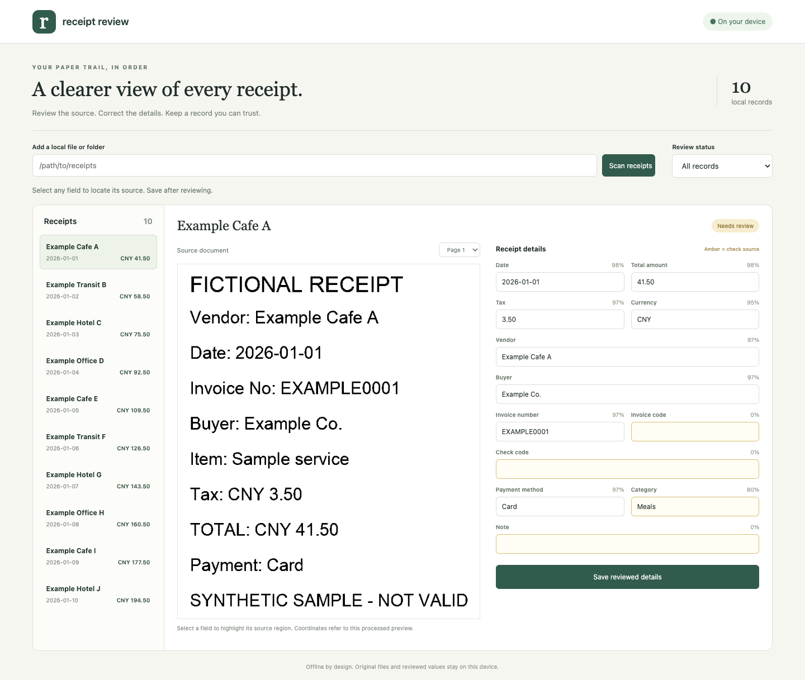

# receipt-ocr-csv

Turn local receipt photos and invoice PDFs into reviewed records and structured exports. Everything runs on your computer: no cloud OCR, account, API key or runtime model download.



RapidOCR includes Chinese/English ONNX models. Electronic PDF pages use their text layer first; scanned pages use OCR. OpenCV preprocessing handles blank borders, shadows, thresholding, mild skew and cardinal rotation retries. A local review screen links fields to their source boxes. CSV, JSON and XLSX exports use your latest reviewed values.

## Quick start

Python 3.11+ on macOS or Linux is required. From a clone of this repository, three commands install and process the fictional examples:

```bash
python3 -m pip install -e .
rocr scan examples/receipts --data-dir data/demo --json --progress
rocr serve --data-dir data/demo --host 127.0.0.1 --port 8889
```

Open `http://127.0.0.1:8889`. Select a receipt, focus a field to highlight its image region, change any value and save. The image is the processed preview, so coordinates remain aligned after rotation/cropping. Page selection supports multi-page PDFs.

For an isolated environment:

```bash
python3 -m venv .venv
. .venv/bin/activate
python -m pip install -e '.[dev]'
```

On minimal Linux systems, install OpenCV runtime libraries with `sudo apt-get install libgl1 libglib2.0-0`. The default engine is installed by pip and needs no system OCR package. Optional HEIC support: `pip install -e '.[heic]'`. Optional Tesseract: `sudo apt-get install tesseract-ocr tesseract-ocr-eng tesseract-ocr-chi-sim`; then select `--engine tesseract`.

## What is extracted

- Date, total amount, tax, currency, vendor, buyer and invoice/receipt number.
- Common Chinese VAT labels for invoice code, invoice number, issue date, tax-inclusive total and verification code; ordinary, special and fully digital invoices share these labeled rules.
- Merchant, total and payment method on retail receipts.
- Category from editable keyword rules, such as Transport, Lodging, Meals and Office.

Every field has a value, confidence, source page/rectangle/text and edited flag. Amber fields are below the configured confidence threshold (0.85 by default). Scores combine OCR confidence and rule strength; they are **heuristic review signals**, not calibrated probabilities. Missing fields stay empty. Unlabeled money is not inferred from the largest number. Clearly labeled totals need two fractional digits.

QR decoding uses OpenCV. A standard VAT QR payload beginning `01,...` provides invoice code/number, date, check code and tax-exclusive amount. That net amount is compared with the text total only when tax is available; it is never substituted for the total. A documented fictional `RECEIPT|date=...|amount=...|invoice_no=...` payload supports direct total comparison. Conflicts lower confidence and remain visible for review. QR data is not authenticity evidence, and no URLs contained in a code are opened.

## Data and configuration

The default directory is `./data`; override it with `--data-dir` or `ROCR_DATA_DIR`. `--config` chooses a YAML file; otherwise `data/config.yaml` is used if present. A relative `categories_file` is resolved beside the config. Without that key, `data/categories.yaml` overrides built-in categories. See [config](examples/config.yaml) and [category rules](examples/categories.yaml).

```text
<data-dir>/
  receipts.db          # Documents, fields and structured records
  config.yaml          # Optional settings
  categories.yaml      # Optional keyword rules
  files/<id>/source.*  # Original input copy
  files/<id>/page-N.png # Aligned preview pages
  backups/*.zip        # Complete dated backups
```

Database records store amounts as integer minor units; interfaces expose exact two-decimal strings. Default timezone is `Asia/Shanghai`; dates use ISO 8601. Original input paths, images and text can be private: the entire runtime directory is ignored by Git. Ten checked-in samples contain only generated fictional merchants and values.

Source identity uses SHA-1 for idempotent repeated ingestion. The same bytes return the existing ID and preserve edits. Different bytes with the same invoice code/number are flagged as possible duplicates; when no number exists, date + amount + normalized vendor is used. Edits refresh duplicate flags. Export includes every record plus `duplicate_of`; review or filter these before computing expenses. No record is silently deleted.

A multi-page PDF is treated as **one invoice**. Each page chooses text extraction or OCR independently. Split PDFs containing unrelated invoices before scanning. Status becomes `parsed` after extraction and `reviewed` after a manual save, including a save with no changed fields. Original extraction warnings remain as provenance after a correction.

## CLI

All commands are noninteractive. Global flags work before or after the subcommand: `--data-dir`, `--config`, `--json`, `--quiet`, `--progress`, `--yes`, `--version`. Results are JSON envelopes; progress is stderr only.

| Command | Purpose |
| --- | --- |
| `rocr scan PATH [--recursive] [--engine rapidocr\|tesseract] [--no-preprocess]` | Scan a file or supported files in a directory |
| `rocr list [--status parsed\|reviewed] [--category NAME] [--date-from DATE] [--date-to DATE] [--duplicates]` | Filter records |
| `rocr show ID` | Full fields, boxes, text, pages, QR and warnings |
| `rocr set ID amount=128.50 category=Transport` | Save reviewed field corrections |
| `rocr export --format csv\|json\|xlsx --out FILE [--no-bom] [--yes]` | Export latest values; explicit overwrite |
| `rocr import FILE` | Validate and atomically import CSV/JSON values |
| `rocr backup [--out FILE.zip]` | Consistent SQLite snapshot plus originals/previews/config |
| `rocr serve [--host 127.0.0.1] [--port 8889]` | Offline review UI |
| `rocr mcp` | MCP stdio server |

```json
{"ok":true,"data":[],"warnings":[]}
```

Errors use `{"ok":false,"error":{"code":"NOT_FOUND","message":"Document not found: missing"}}`. Exit codes: 0 success, 1 processing/partial scan failure, 2 invalid arguments/data, 3 missing data. A batch continues after individual errors and returns both successful IDs and per-file errors. OCR is a long operation; use `--progress`. Read-only commands on a small local dataset normally finish within two seconds.

## Import, export and expense handoff

The stable column order is:

```text
id,date,amount,tax,currency,vendor,buyer,invoice_no,file,invoice_code,check_code,payment_method,category,note,status,duplicate_of
```

The `file` column points to the managed local original copy for direct attachment by an expense tool; imported rows without source images have an empty path. Import treats this pointer as informational and does not read arbitrary files. CSV defaults to UTF-8 BOM; `--no-bom` selects plain UTF-8. XLSX writes all values as literal strings, including money, to preserve exact decimals and prevent formula interpretation. CSV preserves literal values; import text columns as text in a spreadsheet when handling untrusted vendor names. JSON is `{"schema_version":1,"records":[...]}`; a bare array is also accepted for import. Unknown columns, invalid dates/currencies and excess fractional money are rejected before writing anything. Reimporting unchanged normalized values is idempotent. Imports create separate reviewed records, have no source images and can be flagged as duplicates of existing scans. Imported IDs/status/duplicate pointers are recomputed, never trusted as update instructions.

These fields are the receipt interchange contract for `expense-claim-helper`: date, exact amount, currency, vendor, invoice number, category and note, with explicit duplicate flags. Preserve those flags during expense review. Imports do not include OCR provenance; use a backup when moving the complete library.

Backups use SQLite's online backup API and include the original documents, previews, category rules and effective configuration. To restore, stop all writers, unzip a trusted backup into an empty directory and point `ROCR_DATA_DIR` there. Keep external config files separately or restore their values from `effective-config.json`. Do not replace a live database in place.

## MCP

```json
{
  "mcpServers": {
    "receipts": {
      "command": "/workspace/apps/receipt-ocr-csv/.venv/bin/rocr",
      "args": ["--data-dir", "/workspace/data/receipt-ocr-csv", "mcp"]
    }
  }
}
```

The official Python SDK serves four tools over stdio: `ocr_receipt(path, engine="rapidocr", recursive=false, preprocess=true)`, `list_records(filters=null)`, `update_record(id, fields)` and `export_records(format, path)`. Writes are described in each tool. Export never overwrites an existing file through MCP. [AGENTS.md](AGENTS.md) documents parameters and recipes; [tool schemas](docs/mcp-tools.json) are generated from the running SDK.

## Verification

```bash
ruff check .
ruff format --check .
pytest -q --cov=receipt_ocr_csv
```

The `ocr` marker runs the **real bundled ONNX engine** against all ten generated receipts. CI runs this acceptance test on Python 3.11 and 3.12. Only `system` tests for optional system Tesseract are excluded in CI. `examples/generate_receipts.py` regenerates the fictional corpus: eight PNGs (one rotated, one blurred, one with QR), one electronic text PDF and one scanned PDF. Exact date and amount accuracy must each be at least 90%. The checked-in [validation evidence](docs/validation.json) reports the measured result; it describes this small synthetic corpus, not general real-world accuracy.

Other tests cover exact money, bilingual VAT labels, QR conflicts, PDF bypass without invoking OCR, bounds of source boxes, edits and exports, duplicate recalculation, atomic/idempotent imports, consistent backups, argument errors, all MCP tools, real stdio, and Web origin/host restrictions.

## FAQ and limits

**Does it verify whether an invoice is genuine?** No. Use the relevant official verification platform yourself. OCR output and a decoded QR code do not establish validity.

**Why does OCR take longer than a list command?** Loading local ONNX models and image inference are CPU work. First invocation can take several seconds; a batch reuses the engine. There is no upload, telemetry or background model fetch. The optional Tesseract subprocess has a configurable timeout; in-process RapidOCR does not have a hard wall-clock timeout.

**Can every invoice layout be read?** No. Rules cover common explicit English/Chinese labels. Dense tables, curved receipts, handwriting, separate label/value rows, unusual currency formats and severe blur can require review. Automated orientation is based on box direction and date recognition, so it may leave an upside-down but readable page. PDF pages with at least 20 text characters use that text layer; a partial or incorrect hidden layer can require rasterizing the PDF externally before scanning. Encrypted PDFs are unsupported.

**Can multiple users access the UI?** It is a single-user loopback tool with no authentication. Host/Origin checks and JSON-only writes prevent casual cross-site access. It refuses public binds. Trusted local users/processes can read or modify the data directory. Do not expose it through a proxy. Input symlinks are rejected. Configurable file/page/pixel limits bound ordinary input sizes; they are not a hostile-file sandbox.

## Roadmap and license

Planned improvements: layout-specific invoice templates, a perspective-correction preview, export subsets and duplicate exclusion controls, stronger orientation classifiers, and explicit per-document reprocessing with edit preservation.

MIT. Bundled dependencies and OCR model weights retain their upstream licenses. No employer, customer or personal receipt data is included.
